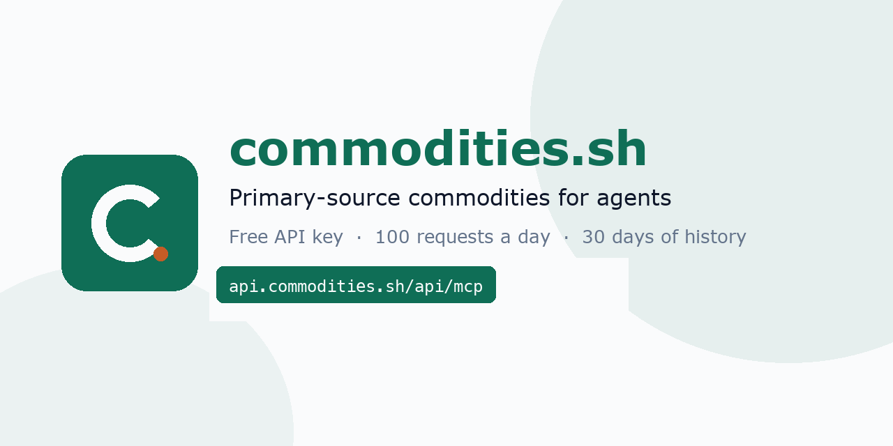

# commodities.sh

[](https://commodities.sh/mcp)

[](https://api.commodities.sh/api/mcp)
[](https://commodities.sh/mcp)
[](https://commodities.sh/signup)
[](https://registry.modelcontextprotocol.io/?search=commodities-sh)

Ask Claude or Cursor for WTI, corn basis, or a crack spread and get the official print, with the source on the observation. EIA, USDA, CFTC, IMF, the Fed, USGS, FAOSTAT, and UN Comtrade. Not exchange futures.

**[Get a free key](https://commodities.sh/signup)** — email signup, no card. 50 requests a day, 10 a minute, and 30 days of history. The 30 days is how far back the key can read. The key does not expire.

## Connect


```
https://api.commodities.sh/api/mcp
```

Put the key in the `Authorization` header. Then call `catalog.search` and turn a commodity name into an instrument code.

### Claude Code

```bash
claude mcp add --transport http commodities https://api.commodities.sh/api/mcp \
  --header "Authorization: Bearer cs_free_…"
```

### Cursor and Claude Code

```json
{
  "mcpServers": {
    "commodities": {
      "type": "http",
      "url": "https://api.commodities.sh/api/mcp",
      "headers": {
        "Authorization": "Bearer cs_free_…"
      }
    }
  }
}
```

Claude Desktop custom connectors have no field for this header. The bridge is on [commodities.sh/mcp](https://commodities.sh/mcp).

### What a call looks like

Cite the fields the payload carries.

```json
{
  "id": "obs_6363a358d0f6971751334765",
  "instrument": "CL",
  "name": "WTI Cushing",
  "value": 78.42,
  "unit": "USD/bbl",
  "as_of": "2026-07-09",
  "freshness_class": "eod",
  "quality": "official",
  "source": { "name": "EIA", "series_id": "PET.RWTC.D" },
  "cite": "EIA PET.RWTC.D as of 2026-07-09 (eod, official)"
}
```

## Free tools

`catalog.list` · `catalog.search` · `calendar.get` · `trade.codes` · `minerals.list` · `cash.reports` · `account.quota`

Six answer with no credential. `account.quota` reads the key already on the connection.

## Free key

 **[Get a free key](https://commodities.sh/signup).** Prefix `cs_free_`.

A free key covers the latest print for every instrument, FX, stats, crack, crush, basis, and 30 days of history. Inventories, COT, USDA and USGS fundamentals, trade, minerals, cash bids, and decision packs are Pro or x402. Upgrading to Pro with the same email keeps the same key string.

x402 is USDC on Base from $0.01, on the REST API. A normal MCP host will not settle it. [How x402 works](https://commodities.sh/x402).

## Pro

 $19 a month or $180 a year. 3,000 credits each month, plus release webhooks. One credit is $0.01. [Get a Pro key](https://commodities.sh/get-started).

## Next

- [MCP setup, tool list, and the Desktop bridge](https://commodities.sh/mcp)
- [Pricing](https://commodities.sh/pricing)
- [llms.txt](https://commodities.sh/llms.txt) and [SKILL.md](https://commodities.sh/SKILL.md) for agents
- [Observation contract](https://commodities.sh/docs)
- Registry: [`io.github.sawftware-apps/commodities-sh`](https://registry.modelcontextprotocol.io/?search=commodities-sh)
